<h1 align="center">🧱 Contribution Tetris</h1>

<p align="center">
  <b>Turn your GitHub contributions into animated retro games for your profile README: a real game of Tetris and a space shooter with a boss fight.</b>
</p>

<p align="center">
  <a href="https://github.com/JuhaP2/contribution-tetris/actions/workflows/test.yml"></a>
  
  
</p>

<p align="center">
  <picture>
    <source media="(prefers-color-scheme: dark)" srcset="assets/demo-dark.svg" />
    <source media="(prefers-color-scheme: light)" srcset="assets/demo-light.svg" />
    
  </picture>
</p>

Tired of the snake? A bot plays an actual game of Tetris on a 10×20 board: the seven classic tetrominoes slide in from the top, drop row by row, and full lines flash and clear. The **score climbs as lines clear and lands on your contribution count** for the last year.

- 🎮 **Real gameplay**, not a slideshow: piece previews, line clears, score and line counters
- 📈 **Your stats**: the final score is your contribution count, and every day plays a different game
- 🌗 **Dark and light** themes that follow the viewer's GitHub theme
- ⚡ **Zero dependencies**: one Python file, pure SVG and CSS, no JavaScript
- 🔁 **Always fresh**: regenerate it on a schedule with GitHub Actions

## 👾 New: Contribution Invaders

<p align="center">
  
</p>

A retro space shooter in the same action. Your ship takes out a marching alien formation that speeds up as it shrinks, dodges bombs behind its shield, then a **WARNING** flashes and a **boss** arrives with its own HP bar and spread shots. Beat it for **STAGE CLEAR**. The score ends at your contribution count, just like Tetris.

## 🚀 Quick start

**1.** Create `.github/workflows/tetris.yml` in your profile repository (the repo named after your username):

```yaml
name: Contribution Tetris

on:
  schedule:
    - cron: "0 */12 * * *"   # twice a day
  workflow_dispatch:
  push:
    branches: [main]

permissions:
  contents: write

jobs:
  generate:
    runs-on: ubuntu-latest
    steps:
      - uses: JuhaP2/contribution-tetris@v1
        with:
          github_user_name: ${{ github.repository_owner }}
          output_dir: dist

      - uses: crazy-max/ghaction-github-pages@v4
        with:
          target_branch: output
          build_dir: dist
        env:
          GITHUB_TOKEN: ${{ secrets.GITHUB_TOKEN }}
```

**2.** Add this to your `README.md`, replacing `USERNAME` with your GitHub username:

```html
<picture>
  <source media="(prefers-color-scheme: dark)" srcset="https://raw.githubusercontent.com/USERNAME/USERNAME/output/tetris-dark.svg" />
  <source media="(prefers-color-scheme: light)" srcset="https://raw.githubusercontent.com/USERNAME/USERNAME/output/tetris-light.svg" />
  
</picture>
```

Want the space shooter too? It's rendered by default, so just add:

```html

```

**3.** Run the workflow once from the **Actions** tab, or just push. Done 🎉

## ⚙️ Inputs

| Input | Default | Description |
| --- | --- | --- |
| `github_user_name` | repository owner | Whose contributions set the score |
| `github_token` | `github.token` | Token used to read the contribution count |
| `output_dir` | `dist` | Folder the SVGs are written to |
| `games` | `tetris,invaders` | Which games to render: `tetris` (tetris-dark.svg, tetris-light.svg), `invaders` (invaders.svg) |

## 🧠 How it works

1. The action reads your contribution count for the last year from the GitHub GraphQL API.
2. A small bot plays Tetris with the classic height, holes and bumpiness heuristic, using a 7-bag piece order seeded by your stats and today's date.
3. Every move is recorded and turned into CSS keyframes inside a single SVG, so it animates anywhere GitHub shows images.

Want to run it locally?

```bash
GITHUB_TOKEN=$(gh auth token) python3 tetris.py YOUR_USERNAME dist
GITHUB_TOKEN=$(gh auth token) python3 invaders.py YOUR_USERNAME dist
```

## 💜 Credits

Made by [**@JuhaP2**](https://github.com/JuhaP2). If Contribution Tetris or Invaders made your profile cooler, **give the repo a ⭐**. It really helps!

Licensed under [MIT](LICENSE).
